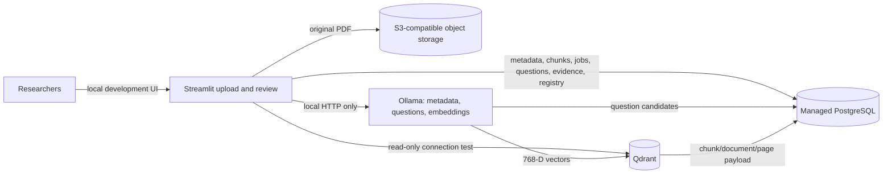
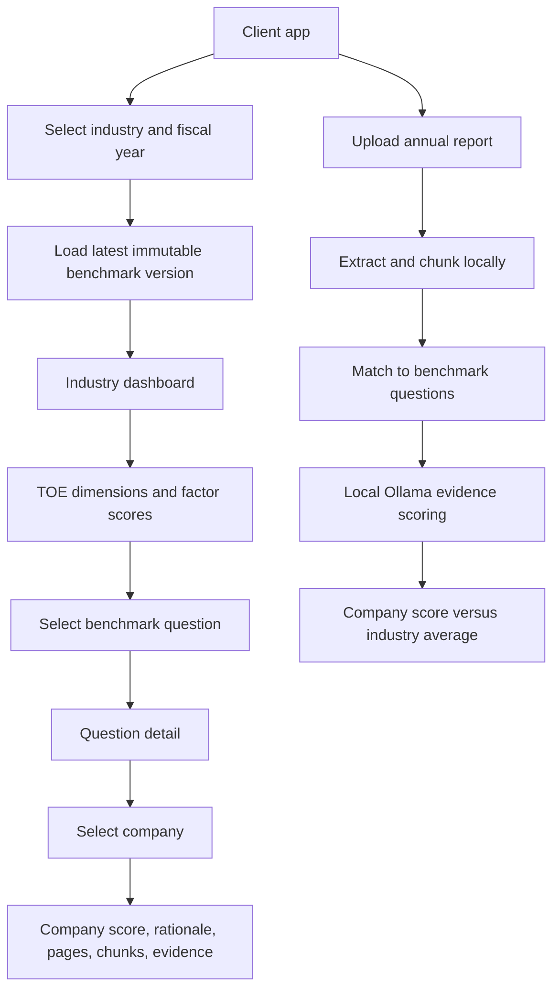
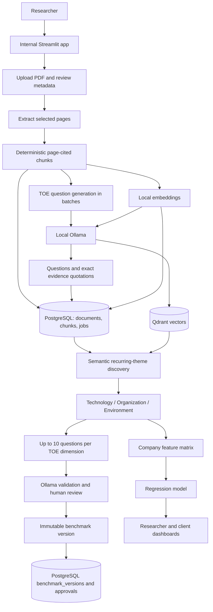
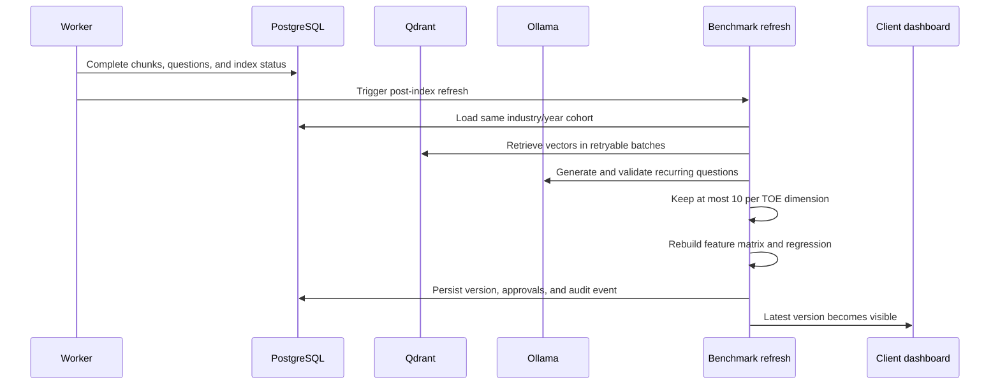

# CIS-FIN Architecture

PostgreSQL is the source of truth for shared research records. Object storage retains original PDFs. Qdrant is a rebuildable vector index that points back to PostgreSQL chunks. Each researcher connects to the same central service accounts and sees the same records; this workspace does not create those cloud accounts or credentials.

The system has two sides: a client-facing benchmark application and an internal researcher/testing application. The five local accounts are suitable for controlled testing, not production identity management.

## Client-facing flow

The client app reads the current benchmark and does not silently modify the training cohort.

## Researcher/testing flow

## Data boundaries

- **PostgreSQL:** company/document metadata, page-cited chunks, question candidates and evidence, review state, embedding registry, processing jobs/checkpoints, assignments, and audit events.
- **Object storage:** original PDF data under deterministic company/checksum keys.
- **Qdrant:** chunk vectors and small retrieval payloads (chunk/document/company IDs and page bounds). It is not the source of truth.
- **Local Ollama:** metadata suggestions, question generation, and vector embeddings. The application accepts only local loopback Ollama endpoints; report text is not sent to a remote model provider.

## Automatic cohort refresh

Fiscal-year spellings such as `25-26` and `2025-2026` are normalized to one cohort. Adding a company creates a new immutable version; it does not rewrite the previous version.

## Scoring model

Each question receives an evidence score from 0–5:

| Score | Meaning |
|---:|---|
| 0 | No evidence or explicit absence |
| 1 | Aspirational or very limited mention |
| 2 | Early or isolated activity |
| 3 | Established capability with evidence |
| 4 | Strong, scaled capability with outcomes or governance |
| 5 | Leading, integrated capability with clear outcomes and improvement |

The dashboard converts question scores to 0–100. Cumulative scores are calculated only from comparable questions in the same normalized industry and fiscal-year cohort. Current regression outputs are provisional evidence-derived pilot scores.

## Recovery behavior

- Processing jobs are checkpointed and resumable.
- Questions are generated in bounded batches.
- Qdrant writes use deterministic IDs and retryable batches.
- A stopped or expired worker lease does not require re-uploading the PDF.
- If benchmark refresh fails after indexing, the source document remains complete and the refresh is deferred.
- PostgreSQL remains the source of truth; Qdrant can be rebuilt from PostgreSQL chunks and the embedding registry.

Qdrant collection name, embedding model, and embedding version scope registry records. The default embedding model emits 768-dimensional vectors. A collection is created only if it is absent and is never deleted/recreated by connectivity tests, uploads, or retries. The pipeline also ensures a keyword payload index on `document_id` for bounded, per-document reconciliation. Use a new collection for an incompatible dimension/model migration.

## Cross-service consistency

PostgreSQL transactions cannot atomically commit object storage or Qdrant operations. The pipeline instead uses deterministic keys/IDs, checksums, checkpoints, retries, and idempotent upserts. Embedding state is recorded as pending in PostgreSQL before the Qdrant write and marked indexed afterward. If the final DB update fails, retrying upserts the same point ID. A document is not marked complete until all required stages and status writes succeed. The pilot supports manual resume; production deployment should add an external scheduler and operational alerts for retry-wait jobs.

## Connectivity safety

| Service | Probe | Write/delete behavior |
|---|---|---|
| PostgreSQL | `SELECT 1` | None |
| Qdrant | `GET /collections` | None |
| Object storage | S3 `HeadBucket` | None |

Ingestion is separate from connectivity tests and requires intentional form submission. The CLI tests run without cloud credentials. Migration application is a separate, explicitly state-changing command.

## Extraction engines

PyMuPDF is the tested default. Docling is optional and unverified; MinerU is not integrated. Any extractor used for grounded evidence must preserve exact original page references.
