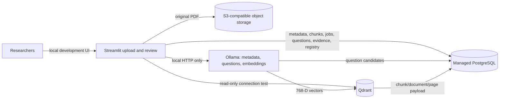

# Architecture

PostgreSQL is the source of truth for shared research records. Object storage retains original PDFs. Qdrant is a rebuildable vector index that points back to PostgreSQL chunks. Each researcher connects to the same central service accounts and sees the same records; this workspace does not create those cloud accounts or credentials.

The Streamlit interface has five environment-configured local accounts for the initial small-team deployment, but it is still not a production identity/access-control system. The researcher uploads a PDF, reviews suggested metadata, selects pages, and submits. The app streams selected-page extraction, persists chunks in bounded batches, automatically generates grounded question candidates with local Ollama, embeds chunks with local Ollama, and upserts stable vector IDs to Qdrant. Questions require review and are not automatically approved.

## Data boundaries

- **PostgreSQL:** company/document metadata, page-cited chunks, question candidates and evidence, review state, embedding registry, processing jobs/checkpoints, assignments, and audit events.
- **Object storage:** original PDF data under deterministic company/checksum keys.
- **Qdrant:** chunk vectors and small retrieval payloads (chunk/document/company IDs and page bounds). It is not the source of truth.
- **Local Ollama:** metadata suggestions, question generation, and vector embeddings. The application accepts only local loopback Ollama endpoints; report text is not sent to a remote model provider.

Qdrant collection name, embedding model, and embedding version scope registry records. The default embedding model emits 768-dimensional vectors. A collection is created only if it is absent and is never deleted/recreated by connectivity tests, uploads, or retries. The pipeline also ensures a keyword payload index on `document_id` for bounded, per-document reconciliation. Use a new collection for an incompatible dimension/model migration.

## Cross-service consistency

PostgreSQL transactions cannot atomically commit object storage or Qdrant operations. The pipeline instead uses deterministic keys/IDs, checksums, checkpoints, retries, and idempotent upserts. Embedding state is recorded as pending in PostgreSQL before the Qdrant write and marked indexed afterward. If the final DB update fails, retrying upserts the same point ID. A document is not marked complete until all required stages and status writes succeed. Full automated reconciliation and scheduled retry workers remain future work.

## Connectivity safety

| Service | Probe | Write/delete behavior |
|---|---|---|
| PostgreSQL | `SELECT 1` | None |
| Qdrant | `GET /collections` | None |
| Object storage | S3 `HeadBucket` | None |

Ingestion is separate from connectivity tests and requires intentional form submission. The CLI tests run without cloud credentials. Migration application is a separate, explicitly state-changing command.

## Extraction engines

PyMuPDF is the tested default. Docling is optional and unverified; MinerU is not integrated. Any extractor used for grounded evidence must preserve exact original page references.
